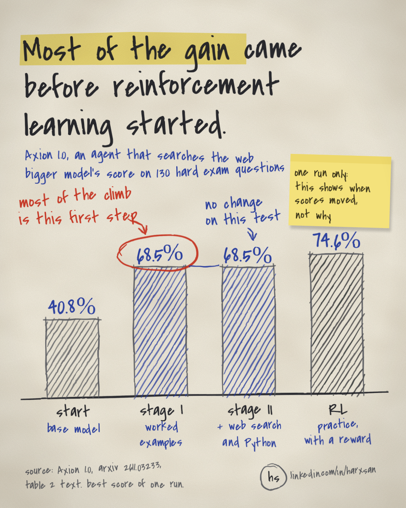

On a 130-question subset of the HLE benchmark, Axion 1.0-122B rises from 40.8% to 68.5% during its first supervised fine-tuning stage, and reinforcement learning later takes it to 74.6%. The paper's own reading of its checkpoints is that much of the capability gain arises during the two supervised fine-tuning (SFT) stages, with RL providing further improvements on selected benchmarks.

## Why it matters

Axion 1.0 is open beyond its weights. The authors release the full recipe, including data construction, filtering, verification, prompts and training code. That makes it easy to copy from start to finish, but the last stage needs the largest setup.

All SFT runs use a 128K context window on 32 GPUs. Both SFT stages together took about 90 GPU-hours for the 35B model; for the 122B model, the figure is 240 GPU-hours. RL for the 122B model runs ten rollout engines on 40 GPUs, a 16-GPU trainer and a separate service node. That node hosts two Qwen3.8-27B judges plus six Qwen3.5-9B instances for webpage summarisation and context condensation.

If the two SFT stages already get far enough on your tasks, you can find that out before you build any of the RL side.

## The setup

The paper trains two main models: 35B-A3B, initialised from Qwen3.6-35B-A3B, and 122B-A10B, initialised from Qwen3.5-122B-A10B. The recipe has three stages: two consecutive SFT stages, then RL. The stated principle behind it is that "simplifying the training pipeline does not require simplifying the learning problem".

The order of the stages is deliberate. In the paper's words, "we train the model to reason before requiring it to retrieve and integrate external information". So Stage I teaches reasoning. Stage II covers retrieval and tool use, starting from the Stage I checkpoint with the same optimisation settings. In both stages, system messages, user messages and tool observations give context but do not count toward the loss.

The reasoning data starts from question–answer pairs taken from public course materials, competitions and reasoning datasets in mathematics, physics, chemistry, biology and computer science. Some questions are built from database tables. The paper's example is to filter for planets with rings, pick the one with the smallest mass, then ask for its mean density. The authors block direct access to the construction-time database tables while allowing general search, webpage visits and Python. Database-grounded questions that can already be answered correctly in a closed-book setting, without retrieval tools, are removed.

RL starts from the Stage II checkpoint, using group-relative policy optimisation (GRPO) on the verl framework. GRPO samples several attempts at the same question, then scores each attempt relative to the others in that group. A correct final answer gets the full reward; otherwise, validated intermediate progress can earn partial credit, while a penalty applies when no final answer is submitted. A later step earns credit only when all its prerequisites have been verified. Verification combines deterministic checks with language-model judgments of semantic equivalence.

Before RL, the questions are filtered. The current model makes four attempts at each candidate question. A question stays only if at least one attempt is correct and the four rewards are not all the same. Those four offline attempts are separate from the eight rollouts used during training.

## The complication

The recipe ends in RL, the stage that needs the largest setup. Yet the paper's checkpoint comparisons put much of the gain in the two SFT stages. RL also does not move every benchmark the same way. On FrontierScience Research it lowers the 35B model from 58.3% to 56.7%, but lifts the 122B model from 65.0% to 66.7%.

There is a second complication, which the authors state themselves. The stage numbers are "sequential checkpoint comparisons" and "not component-removal ablations". They tell you when a score moved during one training run, but they do not tell you what would happen if you skipped a stage.

## The evidence

The diagram puts the HLE-130 score for both models under each stage; the thing to see is that the biggest step comes in Stage I, while RL adds a smaller one on top.

Stage I lifts the 35B model on HLE-130 from 47.7% to 59.2%, on HiPhO from 38.6% to 45.9%, and on FrontierScience Olympiad from 71.0% to 83.0%. The 122B model moves from 40.8% to 68.5% on HLE-130 and from 65.0% to 85.0% on FrontierScience Olympiad. The gains are not universal, though: the 35B model's BMB score drops from 23.5% to 17.6% in this stage.

Stage II more than makes up that drop, taking the 35B model's BMB score from 17.6% to 35.3%. The same stage lifts the 35B model on FrontierScience Research from 48.3% to 58.3%, on SEAL-0 from 50.5% to 53.2% and on HLE-130 from 59.2% to 66.2%. For the 122B model, BMB rises from 29.4% to 35.3% and FrontierScience Research from 56.7% to 65.0%, while HLE-130 stays at 68.5%.

RL then takes HLE-130 from 66.2% to 70.0% for the 35B model and from 68.5% to 74.6% for the 122B model. On SEAL-0, the 35B model goes from 53.2% to 62.2% and the 122B model from 53.2% to 58.6%. For the 35B model, that is a bigger step than Stage II gave on the same benchmark, which was 50.5% to 53.2%. So RL does real work on some benchmarks, which fits the paper's phrase "selected benchmarks".

A side experiment shows how much SFT can even out the starting point. When the paper puts the Qwen3.5 and Qwen3.6 35B-A3B bases through SFT, the HLE-130 difference between them decreases from 9.2% to 0.8%. On BMB, both reach 35.3%. But it is not uniform: after SFT, Qwen3.5 scores higher on SEAL-0, at 57.7% against 53.2%.

The paper also compares the 122B RL run with and without a variant it labels R3. With R3, HLE-130 is 74.6% against 72.3%, FrontierScience Olympiad 87.0% against 85.0%, and FrontierScience Research 66.7% against 61.7%. HiPhO stays similar at 46.2% against 46.3%, but SEAL-0 drops from 63.1% to 58.6%. With R3, the largest gradient spike also rises from 21.1 to 26.8, while the reward standard deviation goes up by 15%. The authors say policy staleness and context condensation effects limit how far these differences can be put down to R3 alone.

The headline table needs its own careful reading. On full HLE, the 35B and 122B models score 52.2% and 59.0% with websites such as Hugging Face blocked. Without those restrictions, they score 59.1% and 64.8%.

Against the similarly sized Agents-A1, which uses long-horizon supervision and domain-routed on-policy distillation, the 35B model compares well. It scores 52.2% against 47.6% on HLE, 62.2% against 56.4% on SEAL-0 and 86.0% against 79.0% on FrontierScience Olympiad. On FrontierScience Research, the 122B model's 66.7% is above GPT-5.6 Sol's 63.3%, Agents-A1's 40.0% and GPT-5.5's 26.7%.

The picture is mixed elsewhere. On BMB, which allows access only to benchmark-approved websites, the 122B model's 41.7% trails GPT-5.6 Sol at 47.1% and Claude Fable 5 at 46.1%. On SEAL-0, the 122B model scores below the 35B model, at 58.6% against 62.2%.

Two notes from the paper change how much weight these numbers carry. Each Axion score is the best result from a single run, rather than an average over several runs. Some baselines come from official reports, while others were evaluated by Agents-A1, Apodex or the authors themselves. Because those may differ in tool access or execution settings, the paper calls cross-source comparisons "indicative rather than strictly controlled".

## Limits

The stage numbers are checkpoints of one training run rather than ablations. HLE-130 is a separate 130-question subset, and the paper says its scores should not be compared directly with the full-HLE results. The 35B and 122B models start from different base architectures and also go through RL, so the paper says not to read them as a controlled size-scaling test.

The 4B and 9B variants get only the two SFT stages, so they tell you nothing about RL at small scale. The example trajectories in the paper describe particular solutions; they do not isolate what any training component contributed. The compute figures in this post cover SFT time only; for RL, the post quotes the hardware layout and gives no run time.

## Takeaway

If you plan to train an agent on this recipe, run the two SFT stages first and measure them on your own tasks. Then decide whether the RL stage, with its rollout GPUs, judge models and summarisation instances, is worth the extra setup. When you read the results table, keep the paper's own single-run scores apart from the baselines it takes from other sources.

I would expect RL to help on some of my benchmarks and slightly hurt others, so I would check each one separately before keeping it.

Source: the Axion 1.0 paper on arXiv (https://arxiv.org/html/2611.03233). Base models from Qwen; GRPO and the verl framework as cited in the paper.