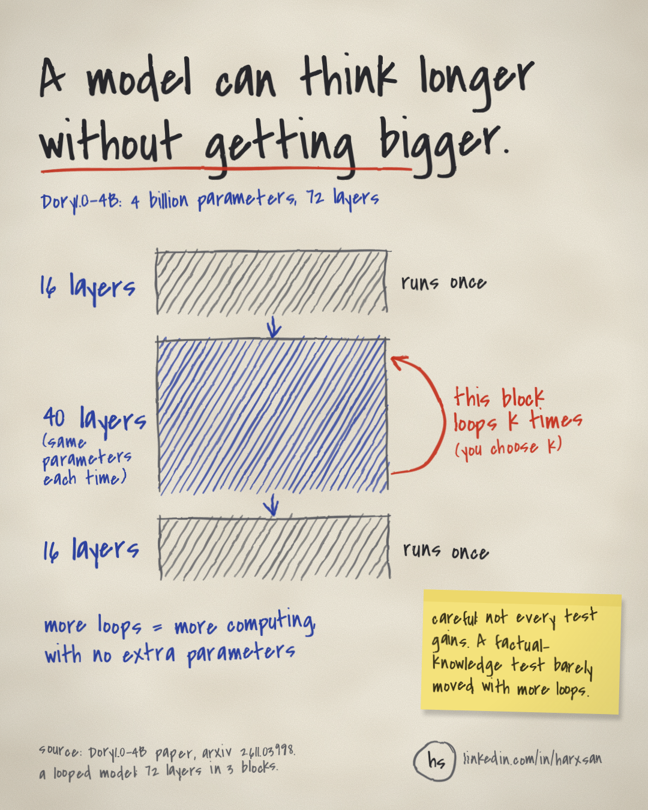

Dory1.0-4B is a 4-billion-parameter language model that can run the middle 40 of its 72 layers once or several times for each token, so one checkpoint spends more compute without adding parameters. But the extra loops help some tasks while others stay flat. On AA-Omniscience, a factual-knowledge benchmark, accuracy stays essentially unchanged across loop counts.

## Why it matters

If you compare models by parameter count and treat it as a rough guide to cost, a looped model will mislead you. A single Dory1.0-4B checkpoint serves different inference compute budgets. The work it does per token becomes a setting you pick when you run it, and its size on disk does not fix that number.

The second risk is paying for depth that does nothing. If you raise the loop count across the board, some of that compute goes to tasks where the paper reports essentially no change.

## The setup

A looped model, also called a latent-recurrent model, applies a shared block of layers again and again, so it spends more computation per token in latent space without adding parameters.

Dory1.0-4B has 72 layers, split into a 16-layer input block, a 40-layer shared recurrent block and a 16-layer output block. The input and output blocks run once. The recurrent block runs k times, and all of its parameters, including the nGPT residual rates, are shared across those runs.

The backbone is nGPT, the normalized Transformer, a design that keeps hidden vectors at unit length. Each sublayer updates the residual stream by blending its normalized output with the normalized residual, using learned per-channel weights, and then normalizing the result. The implementation also L2-normalizes the gated attention outputs before the output projection, and the SwiGLU activations before the MLP down-projection.

The attention layers come in two kinds, interleaved through the stack. Sliding-window layers, where each token attends only to a fixed number of recent tokens, use a window of 1,024 tokens. Full-attention layers look back over the whole context.

Training samples one to four loops. The next-token loss is applied only after the final sampled loop, with no intermediate-exit or early-loop auxiliary losses. A rotating subset, which changes with the training step and microbatch index, adds extra one-loop training signal, so the mix of loop counts the model sees is not uniform.

## The complication

The headline result is easy to repeat. With two or more loops, Dory1.0-4B outperforms larger models such as Qwen3.5-9B, Gemma 4 12B and Gemma 4 26B-A4B on average across 12 benchmarks.

But the same paper is careful to say that gains from deeper execution are task-dependent. Performance also tends to saturate after four loops, which is why the authors restrict post-training results to at most four loops.

The loop range adds one more caveat. Training only samples one to four loops, so the six- and eight-loop evaluations measure inference-depth extrapolation, meaning how the model behaves at depths it was not trained to run.

## The evidence

In the diagram, only the middle 40-layer block has a loop arrow, and its recurrent attention layers keep a single KV cache that each loop overwrites.

On quality, the paper says that unless otherwise specified, all models in its Table 2 ran under an identical protocol for each benchmark, with the same evaluation harness, task configuration and scoring procedure. The authors note that these scores may differ from those published by Artificial Analysis.

Keep in mind what each side spends. With two loops, the model runs its 40-layer recurrent block twice per token, so it uses more compute per token than a single pass would. Parameter count alone hides that difference.

On memory, the paper uses last-loop KV caching, from Ladhak et al. (2026). Each recurrent attention layer keeps one cache and overwrites its entries at each loop, so after each forward step the cache holds the final loop's keys and values.

This keeps the KV-cache footprint equal to that of a non-looped model at any loop count, while retaining most of the accuracy gains. The paper says most, so some of the gain from looping is given up in exchange for memory that stays flat.

For self-speculative decoding, where a model drafts tokens with a cheaper pass of itself and then checks them, the paper uses per-loop KV caches instead.

## Limits

The loop range is the first boundary. Training samples one to four loops, so the six- and eight-loop results test extrapolation, and the post-training results stop at four loops.

The scores come from the authors' own evaluation protocol, and they say the numbers may differ from the ones Artificial Analysis publishes.

The headline comparison is an average across 12 benchmarks. But an average can hide individual tasks where the larger models still come out ahead.

The paper evaluates its inference optimisations separately, and uses per-loop KV caches for self-speculative decoding. So the memory saving from last-loop caching and the results from speculative decoding are not measured together.

Nothing in this post measures wall-clock latency or serving cost. More loops mean more compute per token. But the evidence behind this post gives no timing or price figures, so any speed or cost claim about this model is unverified here.

## Takeaway

Before you treat the loop count as a free quality setting, run your own tasks at each loop count you might serve and see which ones actually move. In the paper, AA-Omniscience accuracy stayed essentially flat, and gains tended to level off after four loops.

When you compare Dory with other models, compare it at the loop count you plan to run. One checkpoint covers several compute budgets, and its parameter count does not tell you which one you are paying for.

I would be careful with loop counts beyond the training range until someone shows they hold up on real tasks.

Source: the Dory1.0-4B paper on arXiv, https://arxiv.org/html/2611.03998. Last-loop KV caching is credited to Ladhak et al. (2026), as cited in the paper.