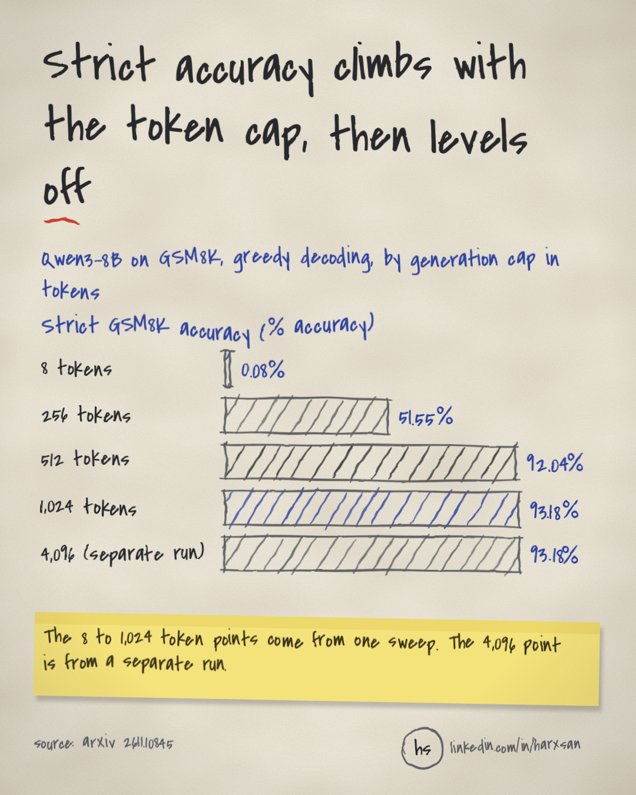

The same model on the same GSM8K test questions scored 51.55% strict accuracy with a 256-token response cap and 93.18% with a larger one. Nothing about the model or the decoding changed between those runs; the only setting that moved was the cap.

The result comes from a new paper on how evaluation settings move LLM benchmark scores. Its authors ran Qwen3-8B through vLLM with greedy decoding.

## Why it matters

When you read a benchmark table to choose a model, you assume the gap between two rows comes from the models. This paper shows how much of a score can come from two quiet settings instead: the length cap and the rule that pulls the final answer out of the text. Copy a harness default for either one, and you can reject a model for failures it never made, or spend days fixing outputs that were simply cut off.

## The setup

The authors swept the response cap from very small to very large, recording two things at each step: strict accuracy and the share of generations that hit the cap. At 8 tokens, every generation reached the cap and strict accuracy was 0.08%. Caps of 8, 16 and 64 tokens truncated every item.

At 256 tokens, 59.2% of generations were still truncated and accuracy was 51.55%. At 512 tokens, truncation fell to 3.0% and accuracy reached 92.04%. At 1,024 tokens, only 0.2% of generations were truncated and accuracy was 93.18%.

Read the bars against the truncation figures above: accuracy climbs as the share of cut-off answers falls, then stops growing once the cap reaches about 1,024 tokens. The bar at 4,096 tokens comes from the paper's second, separate run; the other bars come from the first sweep.

## The complication

A 51.55% score on a math benchmark reads like a weak model. But in this sweep, the score tracks how many answers were cut off before they finished. Once almost nothing is cut off, extra room stops helping.

Moving the cap from 1,024 to 4,096 tokens quadrupled the available maximum, but mean output length rose only from 290.4 to 293.3 tokens. Final answers agreed 99.47% of the time; only seven of them changed. Below a threshold the cap matters a great deal; above it, it hardly matters at all.

## The evidence

A paired comparison makes the low end concrete. On a 512-item GSM8K slice, the 256-token and 1,024-token caps agreed on only 56.84% of answers. The larger cap improved 197 items, harmed none, and left 315 neutral.

The paper reports the sweep a second time, in a separate run, and the figures line up. That run gives 91.96% at 512 tokens and 93.25% at 1,024, against 92.04% and 93.18% in the first sweep. Differences under a tenth of a point between two separately reported runs are what you would expect, so the two sets of figures agree. The second run also stayed at 93.25% at 2,048 tokens and 93.18% at 4,096.

Qwen3's thinking mode shows the same problem in a sharper form. With thinking on and a total cap of 256 tokens, mean reasoning length was 256 tokens, mean answer length was zero, every generation was truncated, and accuracy was 8.4%. The main sweep, at the same 256-token cap, scored 51.55%. With thinking on, the same cap left no room for an answer at all.

The second setting never touches the model at all. The authors took one frozen set of outputs, generated at a 512-token cap, with the generated bytes identical across every scoring row. They then scored those same outputs with three rules for pulling out the final answer.

Taking the last number in the text gave 90.37%, taking the number after "####" gave 87.87%, and a loose phrase/equals pattern gave 54.59%. The paper describes the resulting 35.78-point spread as "created entirely downstream of generation". Same outputs, same model, but the score still moved by more than a third.

## Limits

The main sweep used one model, Qwen3-8B, on the 1,319-item GSM8K test set, in vLLM 0.11.0 with greedy decoding. The paired comparison used a smaller 512-item slice of the same benchmark. The paper says the right cap is specific to the model, task, prompt format and reasoning mode, and should not be inherited from a harness default without measurement. So the threshold seen here, somewhere between 512 and 1,024 tokens, should not be carried over to another model or task.

The extractor comparison has its own boundary. The paper says it does not establish that any one of the three rules is correct for all mathematical outputs. A higher score from one rule shows that rule is more lenient on these outputs; it does not prove that rule is the right one.

On the negative side, extra room above that threshold bought nothing measurable: accuracy was 93.25% at 2,048 tokens, then 93.18% at 4,096. The loose phrase/equals heuristic scored 54.59%, against 90.37% for the last-number rule.

## What to check

Before you trust a benchmark score, or a gap between two models, look for two numbers that often go unreported. One is the share of generations that hit the length cap; the other is the rule used to extract the final answer. If a large share hit the cap, the score is partly measuring the cap. Measure the cap for your own model, task, prompt format and reasoning mode, as the paper recommends, rather than taking the harness default.

I would doubt any math score that does not say which rule pulled the final answer out of the text.

Source paper: <https://arxiv.org/html/2611.10845>
